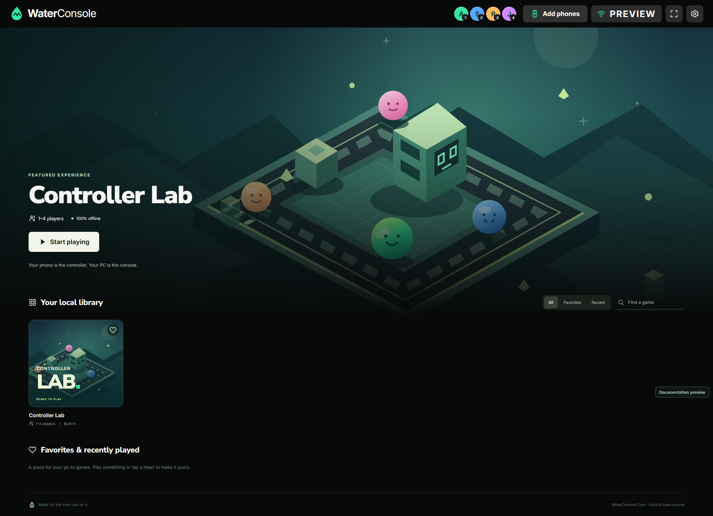
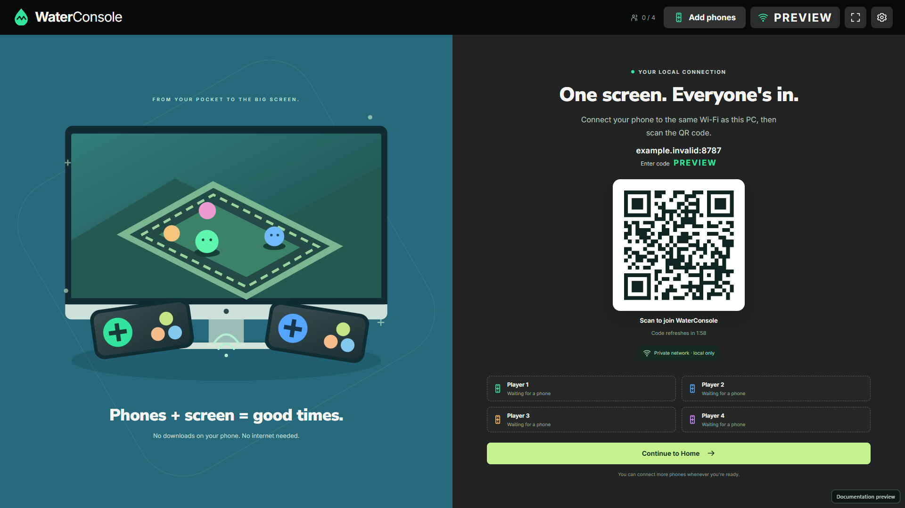
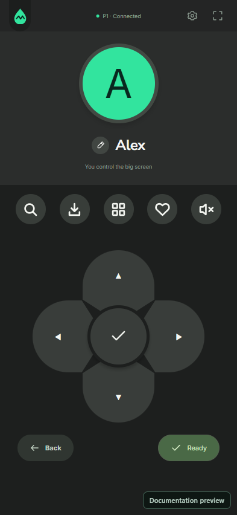
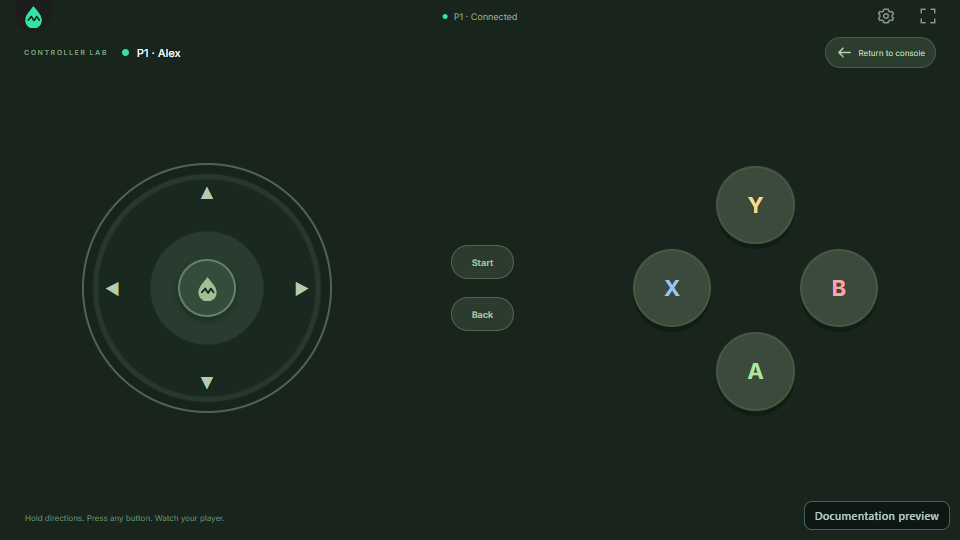
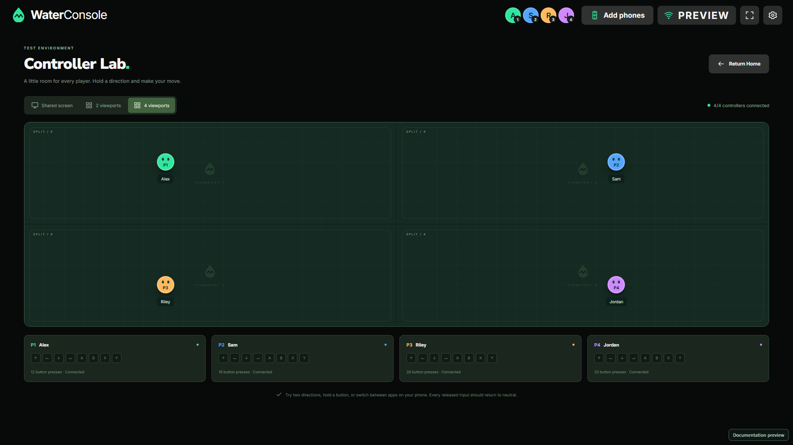
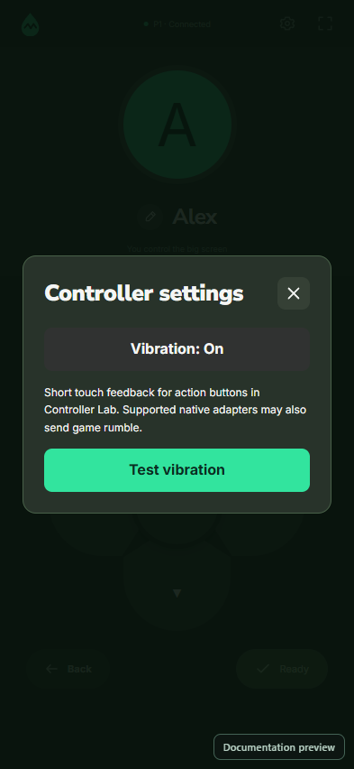

# WaterConsole

### Playing together should be free.

[](LICENSE)
[](docs/INSTALL.md)
[](docs/INSTALL.md#connect-your-phones)

Turn your Windows PC into a local console. Connect up to four phones, approve them on the big screen, and play together on your own network.

**WaterConsole Core** is the free, MIT-licensed foundation: the console interface, PC-approved pairing flow, touch controllers, vibration controls, and Controller Lab. Bring your own games and build adapters when you are ready. No account, subscription, cloud backend, or internet connection is needed to run the installed core.

[**Download for Windows**](https://github.com/YogurtGen/WaterConsole/releases/latest) · [**Website**](https://yogurtgen.github.io/WaterConsole/) · [Installation](docs/INSTALL.md) · [Add a game with AI](docs/ADDING-GAMES.md) · [Troubleshooting](docs/TROUBLESHOOTING.md)



*Documentation preview of the actual interface. Preview players and connection details are illustrative; screenshots are not physical-device test results.*

## Downloads

| Package | Use |
| --- | --- |
| [Windows Setup · v0.2.0](https://github.com/YogurtGen/WaterConsole/releases/download/v0.2.0/WaterConsole-Core-Setup-0.2.0-x64.exe) | Install WaterConsole Core on Windows x64. |
| [Portable ZIP · v0.2.0](https://github.com/YogurtGen/WaterConsole/releases/download/v0.2.0/WaterConsole-Core-0.2.0-x64.zip) | Extract the complete application and run it. |
| [Source ZIP · v0.2.0](https://github.com/YogurtGen/WaterConsole/releases/download/v0.2.0/WaterConsole-Core-Source-0.2.0.zip) | Build or extend the core yourself. |
| [Optional controller tools](https://github.com/YogurtGen/WaterConsole/releases/download/v0.2.0/WaterConsole-Optional-Controller-Tools-0.2.0.zip) | Native adapter development only; includes the separately installed, retired ViGEmBus driver. **Not needed for phone vibration or Controller Lab.** |
| [SHA-256 checksums](https://github.com/YogurtGen/WaterConsole/releases/download/v0.2.0/SHA256SUMS.txt) | Verify downloaded release files. |

## What is included

- **A console for your PC:** fullscreen Home, local library, search, favorites, recent activity, selection animation, and navigation sounds.
- **Phones as controllers:** scan a QR code, request a slot, receive PC approval, then tap **Enter controller**. No phone app is required.
- **Four independent players:** names, colors, readiness, and a host-controlled navigator. The PC approves, removes, or transfers navigation to a player.
- **Controller Lab:** inspect buttons and movement in shared, two-viewport, or four-viewport layouts. The directional pad supports dragging between directions and simultaneous button presses.
- **Per-phone vibration:** an on/off preference, a Test button, and bounded touch feedback on supported browsers. An extension can forward real native game rumble.
- **Local operation:** bundled fonts, graphics, audio synthesis, and scripts; an app-managed HTTP/WebSocket server; reconnect and input recovery.
- **An extension foundation:** semantic input contracts, an empty native adapter registry, and an optional Windows virtual-gamepad toolkit.

Only **Controller Lab** ships. Commercial games, launchers, game binaries, extracted artwork, and game-specific adapters are not included. Selecting a display mode does not add split-screen support to another game.

## Start playing

1. Download the **Setup** installer or **portable ZIP** from [Releases](https://github.com/YogurtGen/WaterConsole/releases/latest). Install or extract it on your Windows PC, then open WaterConsole Core.
2. Connect the PC and phones to the same trusted private Wi-Fi or hotspot. On Windows, allow the app through the firewall for **Private networks** when asked.
3. Scan the current QR code on the PC. Enter your name, compare the verification code, and approve the request on the PC.
4. On the phone, tap **Enter controller**. Open Controller Lab and try the directions, buttons, and layouts.

The installed app includes Electron and its runtime. **Players do not need Node.js, Git, an AI subscription, or a gamepad driver.** See the [download checklist](docs/INSTALL.md#what-to-download) for developer and optional native tools.

<details>
<summary><strong>More of the interface</strong></summary>

| Pair on the PC | Navigate from a phone |
| --- | --- |
|  |  |

| Play with touch controls | Check independent players |
| --- | --- |
|  |  |



All images above are credential-free documentation previews.

</details>

## Build from source

Use Windows 10/11 x64, **Node.js 24 LTS**, and Git. Choose a drive with free space; the scripts keep dependency and build caches inside the checkout.

```powershell
git clone https://github.com/YogurtGen/WaterConsole.git
cd WaterConsole
npm run setup
npm run build
npm start
```

For development, run `npm run dev`. For a Windows installer and portable package, run `npm run dist`. Full prerequisites, browser testing, cache locations, and package contents are in [INSTALL.md](docs/INSTALL.md).

```powershell
npm run typecheck
npm test
npm run test:e2e
```

Automated browser checks cannot establish physical vibration, Android fullscreen, Wi-Fi performance, or native game compatibility. Use the [manual test checklist](docs/TESTING.md) as well.

## Extend your console

Read [ADDING-GAMES.md](docs/ADDING-GAMES.md) for the file map, adapter lifecycle, touch layout guidance, haptics, and ready-to-paste prompts for **Codex** or **Claude Code**. `AGENTS.md` and `CLAUDE.md` keep coding agents aligned with the project.

A native integration must launch the user's own installation, provide tested input mappings, and release every held input when focus or a connection is lost. A card in the library alone does not make a game playable. Optional AI services have their own installation, account, network, and billing requirements; WaterConsole itself has no AI dependency.

**Proposed next feature:** [Add Game and Controller Studio PRD](docs/planning/PRD-GAME-BUILDER.md), with custom library artwork and visual phone-controller editing. This is a design proposal, not a feature in the current download.

## Network and device limits

WaterConsole Core serves controllers over **unencrypted HTTP/WebSocket on a trusted local network**. PC approval and session tokens restrict application access; they do not encrypt traffic or make hostile Wi-Fi safe. Do not expose the server to the internet. Read [SECURITY.md](SECURITY.md).

Android Chrome is the primary phone target. Fullscreen requires a tap; browser or device policy may decline fullscreen, orientation lock, or vibration. Controls remain usable when a browser lacks those APIs. iPhone fullscreen and vibration are not guaranteed. [Vibration details and optional PC components](docs/INSTALL.md#vibration-and-optional-native-support).

## Documentation and support

[Installation and downloads](docs/INSTALL.md) · [Troubleshooting and bug reports](docs/TROUBLESHOOTING.md) · [Architecture](docs/ARCHITECTURE.md) · [Protocol](docs/PROTOCOL.md) · [Testing](docs/TESTING.md) · [Contributing](CONTRIBUTING.md)

Report reproducible issues through [GitHub Issues](https://github.com/YogurtGen/WaterConsole/issues). Please redact QR codes, pairing secrets, tokens, and personal paths. For security issues, follow [SECURITY.md](SECURITY.md).

If the project helps your game night, you can [support its development via yapp.ink](https://yapp.ink/fensulix). Donations are optional; the core remains open source.

## License

WaterConsole source and original project artwork are licensed under [MIT](LICENSE). Third-party components retain their own licenses; see [asset provenance](assets/ASSET-LICENSES.md) and the notices bundled with releases. No ownership or redistribution rights to third-party games are granted.
