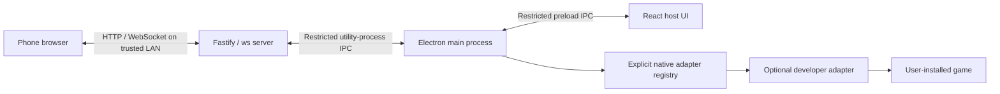

# Architecture

WaterConsole Core is a Windows desktop host plus a local phone-controller service. The public catalog contains Controller Lab; native integrations are explicit developer extensions.

## Processes and authority

**Electron main** owns the window, app lifecycle, restricted `waterconsole://app` host renderer, and native adapter facade. The host renderer runs sandboxed with context isolation and no Node integration. The preload exposes only the typed `HostBridge`; the renderer does not receive a general filesystem or shell API.

**The server utility process** owns session state, four slots, pair tickets/device tokens, navigation rights, input validation, and public controller assets. It starts and stops with the desktop application. It binds to a selected IPv4 interface, preferring normal LAN adapters, and starts its port search at `8787`.

**The phone browser** requests pairing, receives PC approval, and sends semantic input. It can change allowed personal state and, when assigned navigation, navigate the library. It cannot administer the session or configure native executables.

## State and persistence

`src/shared/types.ts` defines manifests, profiles, session/host state, input frames, commands, and callback types. The server is authoritative for phase, epoch, slots, navigation, selected game, profile, layout, and pairing lock. Phone UI state follows server updates.

Local JSON preferences contain favorites, recent entries, mute, and selected network address. Writes use temporary-file replacement. Active session credentials remain in memory; a desktop restart starts a new session. The Core product uses a separate application/settings identity from private builds.

## Input path

1. Pointer Events update per-pointer ownership immediately. A drag pad calculates direction sectors and a dead zone; multiple fingers can hold independent actions.
2. The controller sends a new snapshot on change and periodic snapshots while active. Visual animation and touch feedback do not delay sending input.
3. The server verifies the approved device, allowed actions, slot, epoch, and increasing sequence number, then updates authoritative input.
4. Controller Lab renders that state. A registered native adapter receives validated snapshots through trusted desktop IPC.
5. Input resets on cancellation, hidden tab, disconnect, stale activity, profile/epoch change, stop, or helper failure. Reconnect never restores an old held button.

The watchdog is 300 ms; valid-token reconnect reserves a disconnected slot for 30 seconds. See [PROTOCOL.md](PROTOCOL.md) and source for the exact current schemas and limits.

## Native extensions

`src/electron/adapters.ts` exports an empty `REGISTERED_NATIVE_ADAPTERS` registry. `src/electron/native-game.ts` dispatches only to those explicitly registered adapters. Core does not discover or launch commercial games. The optional generic toolkit can create independent virtual gamepads for a developer adapter; it does not select mappings, bypass authentication, or create split-screen support.

A manifest advertises only the runtime's supported player counts and display modes (`shared`, `split-2`, `split-4`). The three profiles supplied by Core are `menu`, `lab`, and `gamepad`. Native modes are `menu` and `game`.

## Feedback and assets

Local navigation audio is synthesized in the app. Fonts, SVG art, styles, and controller scripts are bundled; the running core needs no CDN. Phone vibration uses a feature-detected browser API, a user gesture, and a per-phone preference. Native rumble is a separate adapter callback routed by valid slot/epoch and runtime state. Touch cues do not infer game collisions.

The static website under `docs/` introduces the product and links downloads/documentation. GitHub Pages is not the controller server: a phone connects to the running PC's displayed LAN address.

Read [SECURITY.md](../SECURITY.md) for the trusted-LAN limitations and [ADDING-GAMES.md](ADDING-GAMES.md) for extension work.
