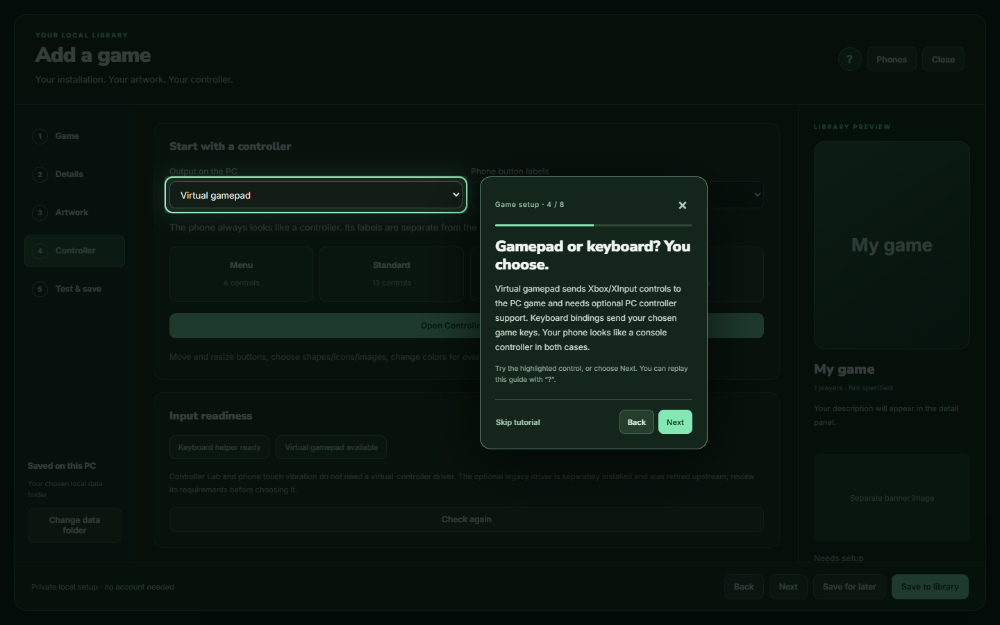
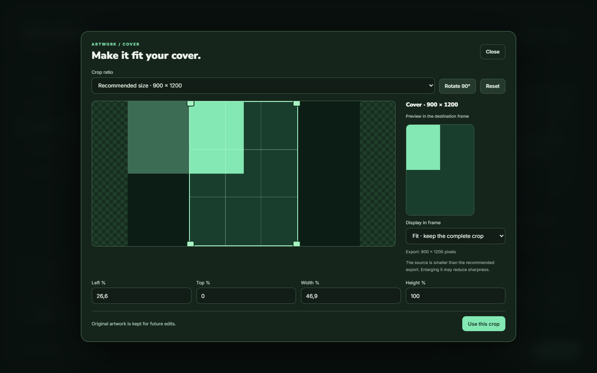
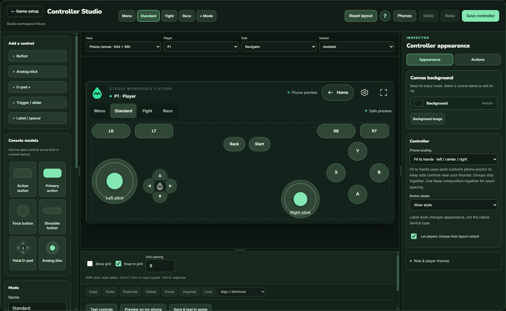
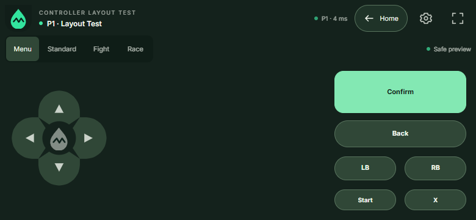
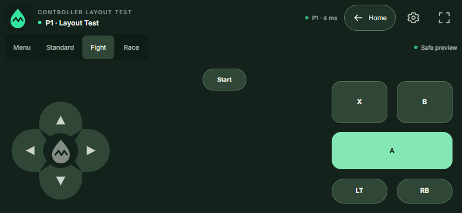
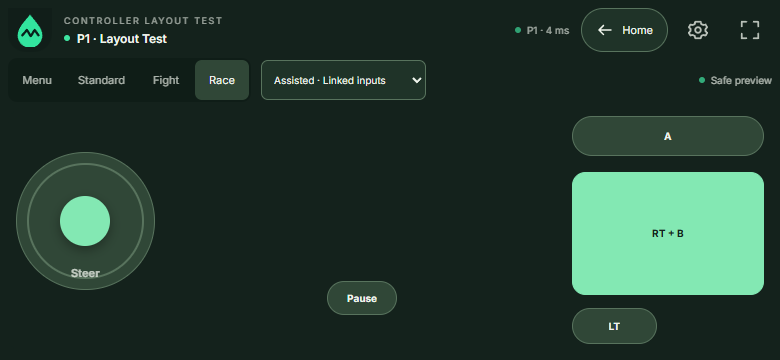

# Add games and design your phone controller

WaterConsole 0.3 lets you add a game without editing source, installing Node, or paying for an AI service. Your original game stays in its own installation. Only Controller Lab is bundled.

## Guided tutorials

On first use, Add Game, crop and Controller Studio offer a spotlight walkthrough: the rest of the screen dims while the current control stays bright and usable. Use **Back / Next**, **Skip tutorial**, or Escape. Skipping does not close your editor or erase changes. Press the **?** button in that workspace header to replay from the beginning. Dismissal is remembered on this PC/browser profile. Tutorials run locally and only navigate the editor; they do not launch or reconfigure a game for you.

## Add a game

1. On Home, click **Add game** beside the library search.
2. Choose the original Windows `.exe`. Picking a file does not start it. Set a title and, if needed, an existing working directory and separate launch arguments.
3. Write a description, choose tags, and set the player count, supported display modes and connection label. These describe your game; they do not add multiplayer or split-screen to it.
4. Upload **Cover** and **Banner** independently. Crop them, then inspect the library preview.
5. Choose **Virtual gamepad** or **Keyboard bindings** for the PC output. Xbox/PlayStation phone labels only change appearance. Open **Controller Studio** to configure controls.
6. Connect and approve your phones. Save, test menus, select the game's input device if necessary, and test actual gameplay. Record your observations in **Test & save**.

If a launcher must open the game, select **Connect to a game I open myself**, open it through its normal launcher, then choose its matching window. WaterConsole disconnects from an attached game on Return Home. For a game launched by WaterConsole, it requests a normal close and waits; a game's confirmation dialog may need your response on the PC. It does not kill processes or bypass login/anti-cheat.

An entry can be saved as **Needs setup** or **Ready to test**. **Tested by you** is your recorded observation, not an automatic compatibility certification. Use the card's edit menu to edit, relink, duplicate or remove a local entry. Removing it does not uninstall the game.

## Browse and manage the game library

Scroll the game row horizontally with the mouse wheel, trackpad or a swipe. The visible left/right arrows browse one page. On an approved Navigator phone, use the Home D-pad's left/right buttons: the selected card automatically scrolls into view on the PC. Phone navigation cannot open PC editing controls.

Right-click an Add Game card, or focus it with Tab and press **Shift+F10** (or the keyboard Menu key). The cover has no extra menu button. **Edit game** opens its details/artwork setup; **Controller Studio** opens its controller directly. **Delete from library…** opens a confirmation: **Keep game** cancels, while **Delete from library** removes only that entry and its WaterConsole controller setup. The installed executable and original artwork are not deleted. Built-in/source-adapter entries show an explanation rather than offering unsupported edits/deletion.

## Cover and banner have different frames

| Destination | Recommended export | Shape |
| --- | --- | --- |
| Cover / library card | 900 × 1200 | 3:4 portrait |
| Banner / detail preview | 1920 × 1080 | 16:9 landscape |
| Custom button image | 512 × 512 | 1:1 |

**Recommended size** is specific to the destination. You can also choose Original, 1:1, 1:3, 3:4, 2:3, 16:9, 3:1 or Free crop. Drag the crop, resize its corners, rotate, or enter coordinates. The destination preview shows **Fit** (complete crop) or **Fill** (cover the frame). Manual crops preserve their chosen proportions; only Recommended exports to the destination pixel size. New banners default to **Fill** so the Home panel is filled edge to edge. Choose **Fit** to show the full image with possible empty space. Existing explicit Fit choices are preserved. The Home panel adapts to the window size and can have a different shape from the exported 16:9 image. A small source may look soft when enlarged.

The normalized original and crop coordinates are kept, so **Re-crop** is reversible. Upload PNG/JPEG/WebP up to 25 MiB and 32 megapixels. Imported images are normalized locally; scriptable SVG/HTML uploads are not accepted. Only use artwork you are entitled to use; a local upload does not grant redistribution rights.

## Controller Studio

Start with **Menu**, **Standard**, **Fight** or **Race**. Modes have their own controls and outputs. Keep Menu for recovery. The current Navigator can switch the shared game mode from the phone; the PC can also switch it. WaterConsole does not guess the game's scene.

- Add buttons, true analog sticks, draggable cross D-pads, triggers/sliders, and decorative labels.
- Select and drag a control; use its resize handle or numeric coordinates. Choose circle, square, triangle, rounded rectangle or pill. Equal-sided shapes keep their proportions.
- Shift-select controls to move/group, align or distribute them. Lock a layer to prevent accidental movement. Undo/Redo keeps the last 50 changes.
- **Show grid** and **Snap to grid** are independent. Set spacing from 1 to 128 design units or switch snap off.
- In Appearance, choose text, icon, icon + text, or your own image. Search the 6,257 bundled Tabler icons offline by name/category/aliases; keep favorites and recent choices. Select an optional pressed image and re-crop the normal image later.
- Edit base/mode/role/player colors and controller background images. For a selected control, use **Button fill**, text/icon tint, border, accent, pressed, disabled and focus colors. Select a canvas control for its contextual **Color & fill** panel. Click **Fill**, **Text** or **Icon** to open one picker. Use **Normal / While pressed** for independent resting/held colors. **More colors** holds border, accent, disabled and focus colors. **Canvas background** stays available without selecting anything; **Role & player themes** holds advanced overrides. **Text color** and **Icon color** are independent; **Pressed text color** and **Pressed icon color** apply while held. Icon tint applies to built-in glyphs and direction symbols; uploaded images keep their own colors. Older profiles without an icon override continue using the text color. Inherited swatches show their effective color. The color picker applies live; use a preset or type HEX and press Enter. Reset an override to inherit its parent. Background/Panels belong to the controller; custom button artwork is under Button content. Change sizes and opacity independently.
- Preview landscape/portrait phone sizes, player slot, Navigator/Other player and the separate PC preview theme. The **host** is the PC; the phone with navigation permission is the **Navigator**. Styling a role does not give it permissions.

Role colors follow the Navigator when the PC transfers that permission. Slot themes follow P1–P4. Per-control overrides take precedence over inherited phone colors. Avoid color combinations with unreadable text.

## Link actions, such as Drift + Throttle

Select a button → **Actions** → **While held, also hold…**. Choose the actual physical inputs used in your game, for example **RT** and **B**, then label the phone button **Drift + Throttle** if that describes your bindings. WaterConsole does not assume that a trigger is acceleration or a face button is drift. Map each semantic action to the actual PC output for the selected player and mode. Up to eight actions/outputs can be held together.

When you press the combined button, both actions start immediately. Releasing it stops its contribution. If a separate Throttle button remains held, throttle stays on until that other touch releases. The same union rule protects shared keyboard outputs across players. Triggers take the greatest active contribution; stick contributions combine and clamp to the valid range.

Use **Show in variant** to make controls Classic-only, Assisted-only or visible in both. New Race presets supply separate RT/B in Classic and a combined RT + B button in Assisted. Existing saved game-specific profiles retain their own names and mappings. Each phone can select its variant when the owner allows it. This is a simultaneous held combination, not a timed macro, script, toggle or repeated-input bot.

For a sliding button cluster, give its buttons the same **Slide-between-buttons group**. Dragging between them releases the previous action without lifting. For continuous steering/movement, prefer an analog stick or 4/8-way D-pad with an adjustable dead zone. Other fingers can keep action buttons held.

## Visual binding, or advanced fields

Select a phone control → **Actions** → **Visual binding**. Choose P1–P4 and a phone control. Pick the Xbox, PlayStation or full ANSI 104 keyboard model, then click inputs to add/remove them. Multiple selections are simultaneous holds. The advanced fields remain available underneath the visual editor.

Gray means unused, green means used, amber means shared by several controls, and blue means assigned to the selected control. Blue with an amber dashed outline is both selected and shared. Hover or keyboard-focus an input to see every phone control using it, its player/variant, and its complete combination (for example A versus A + B). Reusing an input is allowed. Editing a visual assignment preserves other players and controls that previously shared an action.

Gamepad player slots are independent devices; keyboard usage is shown across all players because Windows shares the keyboard. On a phone analog/D-pad, choose the horizontal/vertical axis or click a whole stick/D-pad target to assign both axes. For keyboard directions choose negative (left/down) or positive (right/up). Triggers are unipolar. Up to eight outputs can be assigned per control axis/button.

PlayStation is a label/diagram option: PC gamepad output is still Xbox/XInput. Touchpad, microphone, Home/Share and reserved system/lock keys are displayed disabled because that backend does not provide those features. The original schematic diagrams are bundled locally and use no manufacturer photos.

## Adjust a layout on your own phone

Open the phone's gear → **Adjust layout**. Drag a control to move it; drag its corner to scale it proportionally. D-pads and analog sticks move as one unit. Controls stay inside the available phone canvas, with a minimum touch size. **Done** saves on this browser, **Cancel** discards changes, and **Reset** restores the host layout (press Done to keep that reset).

This works for declarative Studio controllers and supported source-defined controllers. Bindings, colors, ownership and other players are unchanged. Each phone/game/mode/variant and portrait/landscape layout has its own local settings. Clear browser storage to remove them. Input and vibration are paused while editing; losing focus or changing screen orientation cancels an unfinished edit.

When a game controller or Studio phone preview is active, WaterConsole requests landscape after fullscreen has been entered, including the game's Menu mode. You do not need to switch to Standard, Fight or Race first. Switching between Menu, Standard, Fight and Race keeps the same landscape lock without a portrait transition. Returning to the WaterConsole Home releases the orientation lock. Android Chrome normally supports this; fullscreen still requires a tap. If the browser rejects orientation lock, the controller shows a rotate/fullscreen hint and remains usable. No CSS fake rotation is applied to touch coordinates.

## PC output and compatibility

Each player/mode has separate bindings in the Actions inspector. **Gamepad** outputs use standard buttons, sticks and triggers. The standard D-pad sends independent directional button bits; analog sticks remain separate axes. Use Directional buttons to map negative/positive axis directions when needed. **Keyboard** outputs use the fixed game-key allowlist; phones never send raw keys. Separate key sets only work if the original game supports separate keyboard players. Global OS escape shortcuts are filtered; games running at a higher integrity level may decline input.

Virtual gamepads need the separately installed optional PC driver described in [INSTALL.md](INSTALL.md#vibration-and-optional-native-support). The helper/client is bundled, but the system driver never installs silently. Upstream support for that legacy driver has ended. A driver probe or working menu does not prove the game's racing/fighting controls use the same device: select the matching controller inside the game and test gameplay.

## Preview, fitting and vibration

**Preview on my phone** sends a sanitized draft to approved phones. It does not inject input into a game. Editing remains on the PC. End preview or choose **Save & test in game** to launch explicitly.

Layouts use a logical 960 × 540 canvas. The phone reserves its toolbar and safe areas, preserves control proportions, using the selected fit mode without rearranging your controls. Small visuals receive larger invisible touch targets. If there is still insufficient space, it shows an actionable rotate/simplify message instead of clipping controls. Check your layout on the actual phone, especially with many controls. Do not place dozens of required controls in a tiny viewport and expect them all to remain comfortable.

On each phone, use **Controller settings → Vibration → Test vibration**. Press feedback is configurable up to 100 ms per control and can be disabled per phone. Native feedback is forwarded only from a real controller rumble callback for the matching active slot/epoch. A button pulse is not collision detection. Browser/device support varies; physical vibration requires a real-phone check.

Input is released on cancellation, lost capture, focus/tab/connection loss, mode/epoch change and watchdog expiry. Reconnect restores the reserved slot, never old held buttons. Settings pause controls; leaving fullscreen does not disconnect the phone.

## Data and recovery

Catalog, images and drafts are local in the **Saved on this PC** folder shown by the wizard. Use **Change data folder** to copy the library to another drive. It preserves the previous folder. Back up the entire `library` directory while the app is closed, including its images. The app also keeps an atomic previous catalog and preserves a damaged file for recovery.

Do not publish your catalog: it contains personal executable paths and arguments. Shareable sanitized presets/import/export, advanced analog curves and reusable user templates are future extensions. For specialized controller behavior or supported game telemetry, the [source/AI route](ADDING-GAMES.md) remains available alongside this editor.
Button images: **Remove image** and **Remove pressed image** clear their own image/crop references. Removing the last image returns the button to text; Undo can restore it. Images and their crop preview follow circle, square, triangle, rounded-rectangle and pill shapes. **Button image fit** selects Fill/cover or Fit/proportional display. Original files remain unchanged.

### Launching or connecting

Use **Choose running game** beside **Browse .exe** to search open application windows. Select the game itself; WaterConsole fills its original executable and working directory without copying it. Review the title/controller, then save. The window list and executable paths are available only in the PC editor.

**Start game** first reuses a matching open game window. **Auto · original launcher or executable** launches through the official Steam or Epic client when the selected executable matches a local installed-game manifest; otherwise it opens the executable directly. **Direct executable** forces the latter. Custom arguments use the direct route; configure Steam launch options in Steam when needed. WaterConsole waits for the actual game window rather than attaching to a short-lived launcher process.

Leave **Only connect to an already running game** off for normal use. Turn it on only when WaterConsole should never launch that entry. A saved PID is a preference: a single matching current window can be reused after a restart; multiple matching windows require an explicit selection. A game you opened yourself stays open when returning Home. A game WaterConsole started is closed normally. No launcher, login or game ownership checks are bypassed.

## Phone fit and built-in console models

The **Console models** palette adds soft action/primary/face/shoulder buttons, a petal D-pad and an analog disc. Each is editable and adds one control without replacing your design. Select a control to choose its Visual style, D-pad model, colors, icon/image and **Phone anchor**.

**Phone scaling → Fit to hands** uses left, center and right anchors so controls do not collect in the middle of a wide phone. It preserves proportions and spacing within each anchored group. Group related controls to keep them together. **Keep composition together** uses one uniform transform for exact relative spacing, while **Preserve full design canvas** also keeps unused outer margins. None of these modes greedily reorders controls. Visual shapes stay proportional; small controls get enlarged invisible touch targets.

Studio opens on a **Phone canvas**. Select, drag and resize controls directly on the same header/layout used by the phone. Choose the phone size in **View**. **Test controls** temporarily switches from editing to local touch testing; **Back to editing** restores the edit handles. **Preview on my phone** sends the current draft to approved phones without running a game. The advanced **Raw coordinates · 960×540** view remains available. Phone settings → Adjust layout → Reset → Done restores the host layout if a previously saved personal adjustment is getting in the way. Never erase personal adjustments silently.

The custom header follows WaterConsole's existing controller interface: game/player identity, connection/latency, Return Home, settings, fullscreen and segmented modes. See [store import](STORE-IMPORT.md) for filling an editable game setup from Steam or Epic.

## Resize your Studio workspace

Drag the divider beside **Controls**, beside the **Inspector**, or above the bottom tools to share space with the neighboring canvas. The preview scales to its available area. Each pane scrolls independently, and model cards adapt to the width. Panel sizes are remembered on this PC.

Double-click a divider to restore that pane, or press **Reset layout** in the header to restore all panel sizes. This never resets buttons, images, bindings or your game. A focused divider also supports arrow keys, Shift for a larger step, Home/End for its limits and Enter to restore its default size. Escape cancels a resize.

## Copy, paste and duplicate controls

Select a control, then press **Ctrl+C** and **Ctrl+V**, or use **Copy / Paste** in the tools area. **Ctrl+D** duplicates the selection immediately. Shift-click controls or Layers to select several. Paste works in another mode or another game setup in the same app session. It keeps the selected controls' settings and all players' gamepad/keyboard bindings. Inherited colors continue to follow the destination theme.

Copies have new control, binding and group identities, so editing their binding does not overwrite the original. Related copied controls keep their spacing; new copies are unlocked. Undo/Redo covers the entire paste. Control/analog limits are checked before changing the design.

The controller clipboard stays inside WaterConsole and clears when the app closes. Text fields retain their usual text-copy shortcuts. **Reset layout** affects workspace panels only.

## Built-in starting templates

New controllers and **Start from preset** use the refreshed Menu, Standard, Fight and Race layouts: soft buttons, petal directions, consistent spacing and hand anchors. Primary actions follow the player accent; explicit control colors still take priority. Race offers separate RT/B or a simultaneous RT+B hold. These are physical bindings, not promises about a game's controls. Check and edit them against the original game.

Saved layouts are preserved. To refresh one mode, choose its template under **Start from preset**. This replaces that mode's controls and bindings; Undo restores the previous design. Other modes stay unchanged. **Reset layout** only restores workspace panels.

Original browser previews of the starting templates:

