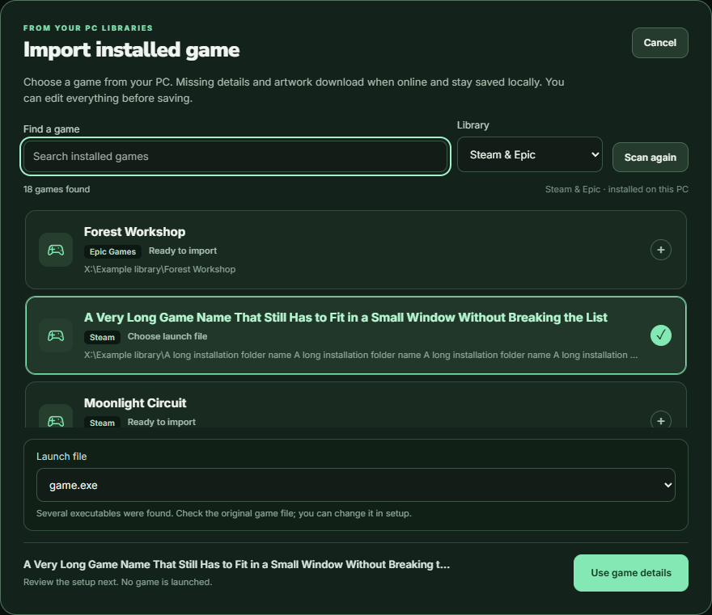

# Import installed Steam and Epic games

*Original documentation fixture. The sample titles and paths are not bundled games.*

Open **Add game → Scan Steam & Epic**, choose an installed game and press **Use game details**. If more than one executable is found, review the choice. You can still use **Browse .exe** or **Choose running game**. The scan and selection do not start a game or save a library entry.

WaterConsole reads local installation manifests and Steam artwork first. Missing official descriptions, available genre tags and cover/banner artwork download when online, then stay cached in your local library. A store tag is also added. No store account is required by the importer. Unreachable, delisted or differently named store pages may leave fields empty; local setup still works and every imported field remains editable.

Review **Details**, **Artwork** and **Controller**, then save. Import keeps an in-progress controller and its bindings. Choose supported player counts, connectivity labels and input bindings yourself; store metadata does not prove that a game works offline or accepts a particular controller. An imported entry starts unverified with one player, a shared screen and unknown connectivity.

Steam detection uses the local client registry/libraryfolders file and installed app manifests. Epic detection uses installed base-game `.item` manifests; incomplete installs and DLC-only entries are excluded. Executable inference can be imperfect, especially for launchers or games with several binaries. Windows game installations are supported; shortcuts, uninstalled games, non-Windows titles and an online account's full owned library are outside this scan.

Auto launch reuses a matching open game first. Otherwise it uses the original Steam/Epic client when a local manifest matches the selected executable. Direct and custom arguments open the executable. Sign-in, updates, ownership and online requirements remain the original game's responsibility. A user-opened game stays open on Return Home; a console-started game receives normal close and is checked for exit.

Metadata and normalized images live under the library's `store-cache` and `images` directories. Keep the complete library in backups. Artwork belongs to its publisher and is never bundled into WaterConsole's public installer/source. No launcher credentials, cookies or browser caches are accessed. A phone cannot scan installations, download arbitrary URLs or change launch settings.
