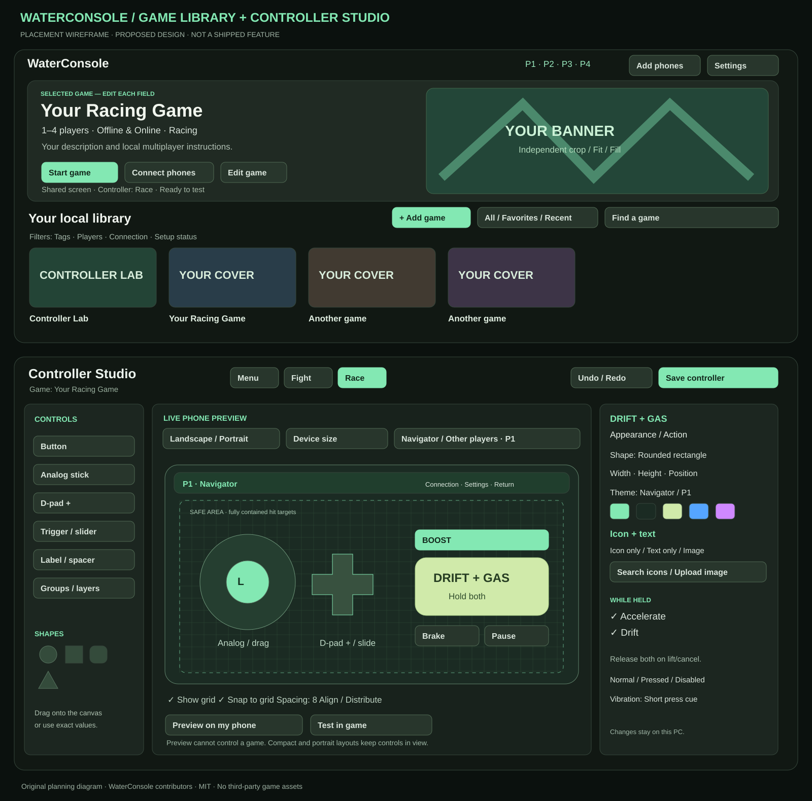

# Proposed WaterConsole game and controller builder

**Planning only. These features are not part of the current Core download.**

- [Product Requirements Document](PRD-GAME-BUILDER.md): Add Game, crops, tags, Controller Studio, themes, shapes, analog/drag, grids, responsive fitting, native input and release gates.
- [UI wireframe](UI-WIREFRAMES.svg): original placement study for Home/library and Controller Studio.
- [Icon research](CONTROLLER-ICON-CATALOG.md) and [verified metadata seed](controller-icon-catalog.json).

The next step is feasibility/design review, followed by the staged implementation in the PRD. No new installer release is created by this planning update.

